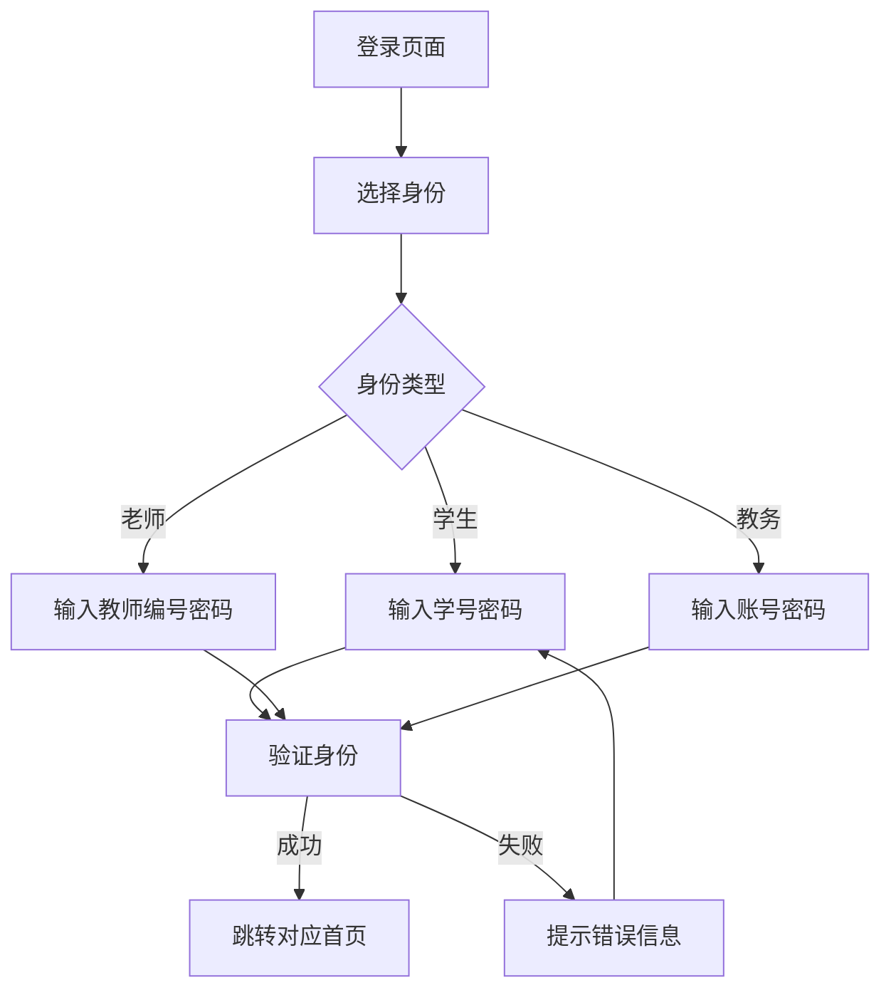
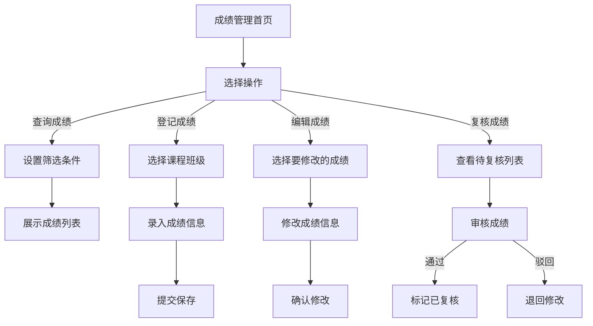
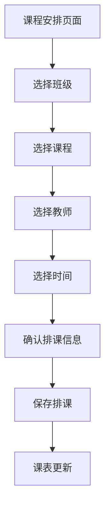

## 1. 产品概述
教务系统是一个面向学校的成绩管理和课程安排平台，支持学生、任课老师、班主任老师和教务四种身份的用户操作，实现成绩查询、登记、编辑、复核以及课程安排等核心功能。
- 主要目的：简化教务管理流程，提高成绩管理效率，实现信息透明化
- 目标用户：学校学生、任课老师、班主任老师、教务管理人员

## 2. 核心功能

### 2.1 用户角色
| 角色 | 登录方式 | 核心权限 |
|------|----------|----------|
| 学生 | 学号登录 | 查询个人成绩、查看个人课表 |
| 任课老师 | 教师编号登录 | 登记成绩、查询成绩、查看个人课表 |
| 班主任老师 | 教师编号登录 | 查询成绩、复核成绩、查看班级课表（不能编辑成绩和排课） |
| 教务 | 账号登录 | 查询成绩、登记和编辑成绩、复核成绩、排课（最高权限） |

### 2.2 功能模块
1. **登录页面**：身份选择、账号密码登录、验证码验证
2. **成绩管理模块**：成绩查询、成绩登记、成绩编辑、成绩复核
3. **课表管理模块**：课表查看、课程安排（仅教务）
4. **个人中心**：用户信息展示、密码修改

### 2.3 页面详情
| 页面名称 | 模块名称 | 功能描述 |
|----------|----------|----------|
| 登录页面 | 身份选择 | 选择学生/老师/教务身份进行登录 |
| 登录页面 | 表单登录 | 输入账号密码进行身份验证 |
| 成绩查询 | 搜索筛选 | 根据班级、课程、学号等条件筛选查询成绩 |
| 成绩查询 | 成绩列表 | 展示成绩详情，支持分页 |
| 成绩登记 | 录入表单 | 选择课程和学生，录入成绩信息 |
| 成绩编辑 | 修改表单 | 修改已登记的成绩信息 |
| 成绩复核 | 复核操作 | 对已登记的成绩进行审核确认 |
| 课表查看 | 课表展示 | 按周展示课程安排，支持切换周次 |
| 课程安排 | 排课表单 | 选择班级、课程、教师、时间进行排课 |
| 个人中心 | 用户信息 | 展示当前登录用户信息 |

## 3. 核心流程

### 3.1 登录流程

### 3.2 成绩管理流程

### 3.3 排课流程

## 4. 用户界面设计

### 4.1 设计风格
- **主色调**：深蓝色(#1e3a5f)作为主色，搭配浅蓝色(#4a90d9)作为辅助色，传达专业、稳重的教育氛围
- **辅助色**：绿色(#2ecc71)用于成功状态，红色(#e74c3c)用于错误状态，橙色(#f39c12)用于警告状态
- **按钮风格**：圆角矩形，主按钮采用渐变色，悬停时有微动画效果
- **字体**：采用清晰易读的无衬线字体，标题使用较大字号加粗，正文使用适中字号
- **布局**：卡片式布局，信息层次分明，左侧导航栏+右侧内容区的经典管理后台布局
- **图标**：使用简洁的线性图标，增强视觉识别性

### 4.2 页面设计概览
| 页面名称 | 模块名称 | UI元素 |
|----------|----------|--------|
| 登录页面 | 整体布局 | 居中登录框、背景渐变、学校logo展示 |
| 登录页面 | 身份选择 | 三个卡片式身份选项，点击切换 |
| 登录页面 | 表单区域 | 账号密码输入框、登录按钮、忘记密码链接 |
| 首页 | 顶部导航 | 用户信息、退出按钮、系统标题 |
| 首页 | 侧边栏 | 功能菜单列表，当前选中项高亮 |
| 首页 | 内容区域 | 数据统计卡片、快捷操作入口 |
| 成绩管理 | 查询区域 | 筛选条件下拉框、搜索按钮 |
| 成绩管理 | 表格区域 | 成绩数据表格、分页组件、操作按钮 |
| 课表管理 | 日历视图 | 周视图课表，不同课程用不同颜色区分 |
| 课表管理 | 排课区域 | 排课表单、时间选择器 |

### 4.3 响应式设计
- **桌面端**：完整布局，左侧导航栏+右侧内容区
- **平板端**：导航栏可折叠，内容区域自适应
- **移动端**：导航栏转为底部标签栏，表单单列展示

### 4.4 交互细节
- 表单验证实时反馈
- 按钮点击有按压效果
- 页面切换有平滑过渡动画
- 表格支持排序和筛选
- 模态框弹出时有缩放动画