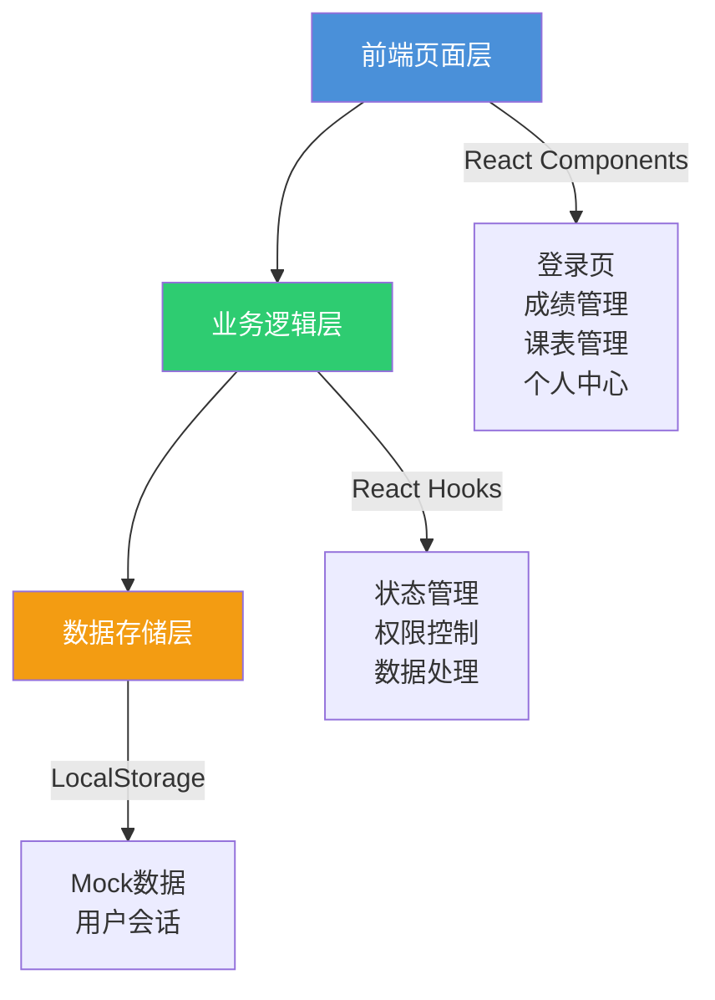
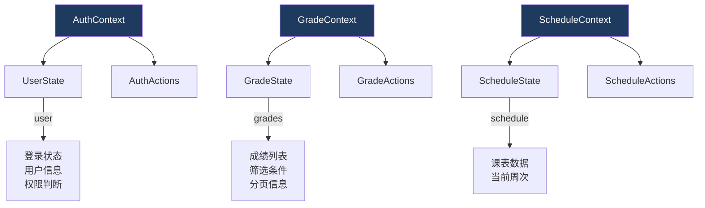

## 1. 架构设计


## 2. 技术描述
- **前端框架**: React@18 + TypeScript
- **构建工具**: Vite@6
- **样式框架**: TailwindCSS@3
- **图标库**: Lucide React
- **路由管理**: React Router DOM@6
- **状态管理**: React Context + Hooks
- **数据存储**: LocalStorage（Mock数据）

## 3. 路由定义
| 路由 | 路径 | 目的 | 权限要求 |
|------|------|------|----------|
| 登录页 | `/` | 用户登录入口 | 无 |
| 首页 | `/dashboard` | 系统首页，展示统计信息 | 所有登录用户 |
| 成绩查询 | `/grades` | 查询成绩列表 | 所有登录用户 |
| 成绩登记 | `/grades/register` | 录入新成绩 | 任课老师、教务 |
| 成绩编辑 | `/grades/edit/:id` | 修改已有成绩 | 教务 |
| 成绩复核 | `/grades/review` | 复核待审核成绩 | 班主任、教务 |
| 课表查看 | `/schedule` | 查看个人/班级课表 | 所有登录用户 |
| 课程安排 | `/schedule/arrange` | 安排课程 | 教务 |
| 个人中心 | `/profile` | 用户信息管理 | 所有登录用户 |

## 4. API定义（Mock）
### 4.1 用户认证
| API | 方法 | 路径 | 说明 |
|-----|------|------|------|
| 登录 | POST | `/api/auth/login` | 用户登录验证 |
| 登出 | POST | `/api/auth/logout` | 用户登出 |
| 获取用户信息 | GET | `/api/auth/user` | 获取当前用户信息 |

### 4.2 成绩管理
| API | 方法 | 路径 | 说明 |
|-----|------|------|------|
| 查询成绩列表 | GET | `/api/grades` | 获取成绩列表（支持筛选） |
| 获取单条成绩 | GET | `/api/grades/:id` | 获取成绩详情 |
| 登记成绩 | POST | `/api/grades` | 新增成绩记录 |
| 编辑成绩 | PUT | `/api/grades/:id` | 修改成绩记录 |
| 复核成绩 | PUT | `/api/grades/:id/review` | 审核成绩 |

### 4.3 课表管理
| API | 方法 | 路径 | 说明 |
|-----|------|------|------|
| 查询课表 | GET | `/api/schedule` | 获取课表列表 |
| 排课 | POST | `/api/schedule` | 新增课程安排 |
| 更新课表 | PUT | `/api/schedule/:id` | 修改课程安排 |
| 删除课表 | DELETE | `/api/schedule/:id` | 删除课程安排 |

### 4.4 数据类型定义
```typescript
interface User {
  id: string;
  name: string;
  role: 'student' | 'teacher' | 'homeroom_teacher' | 'admin';
  username: string;
  classId?: string;
  department?: string;
}

interface Grade {
  id: string;
  studentId: string;
  studentName: string;
  classId: string;
  className: string;
  courseId: string;
  courseName: string;
  teacherId: string;
  teacherName: string;
  score: number;
  fullScore: number;
  gradeLevel: string;
  status: 'pending' | 'reviewed' | 'rejected';
  reviewComment?: string;
  createdAt: string;
  updatedAt: string;
}

interface Schedule {
  id: string;
  classId: string;
  className: string;
  courseId: string;
  courseName: string;
  teacherId: string;
  teacherName: string;
  dayOfWeek: number;
  period: number;
  classroom: string;
  startDate: string;
  endDate: string;
}

interface Course {
  id: string;
  name: string;
  code: string;
  credit: number;
  department: string;
}

interface Class {
  id: string;
  name: string;
  grade: string;
  major: string;
  homeroomTeacherId: string;
}
```

## 5. 状态管理架构


## 6. 数据模型

### 6.1 数据模型关系
```mermaid
erDiagram
    USER ||--o{ GRADE : "拥有"
    USER ||--o{ SCHEDULE : "授课/上课"
    COURSE ||--o{ GRADE : "关联"
    COURSE ||--o{ SCHEDULE : "关联"
    CLASS ||--o{ USER : "所属"
    CLASS ||--o{ GRADE : "关联"
    CLASS ||--o{ SCHEDULE : "关联"

    USER {
        string id PK
        string name
        string role
        string username
        string classId FK
    }

    GRADE {
        string id PK
        string studentId FK
        string classId FK
        string courseId FK
        string teacherId FK
        number score
        string status
    }

    SCHEDULE {
        string id PK
        string classId FK
        string courseId FK
        string teacherId FK
        number dayOfWeek
        number period
        string classroom
    }

    COURSE {
        string id PK
        string name
        string code
        number credit
    }

    CLASS {
        string id PK
        string name
        string grade
        string major
        string homeroomTeacherId FK
    }
```

### 6.2 Mock数据
系统将使用LocalStorage存储Mock数据，包含：
- 用户账号信息（学生、任课老师、班主任、教务）
- 课程信息
- 班级信息
- 成绩记录
- 课表数据

初始数据将在应用启动时初始化，支持基础的增删改查操作。

## 7. 项目结构
```
src/
├── components/          # 通用组件
│   ├── Layout/         # 布局组件
│   ├── Table/          # 表格组件
│   ├── Form/           # 表单组件
│   └── Modal/          # 模态框组件
├── contexts/           # Context状态管理
├── pages/              # 页面组件
│   ├── Login/          # 登录页
│   ├── Dashboard/      # 首页
│   ├── Grades/         # 成绩管理
│   ├── Schedule/       # 课表管理
│   └── Profile/        # 个人中心
├── hooks/              # 自定义Hooks
├── data/               # Mock数据
├── utils/              # 工具函数
├── types/              # TypeScript类型定义
├── App.tsx             # 主应用组件
├── main.tsx            # 入口文件
└── index.css           # 全局样式
```